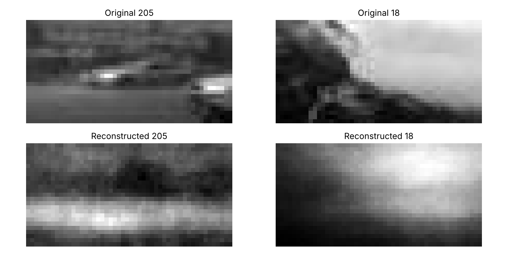

# Autoencoder Image Compression

A fully connected autoencoder in PyTorch that compresses 25×50 greyscale images (1,250 pixels) into a 32-number code and reconstructs them, storing 39× fewer values per image.

**Built:** March 2025, as Year 2 Machine Learning coursework for my Computer Science degree at the University of Bath.
**Revisited:** October 2026. I made the results reproducible and added a PCA baseline (details below).

## Model

| | Layers |
|---|---|
| Encoder | 1250 → 512 → 128 → 32 (ReLU) |
| Decoder | 32 → 128 → 512 → 1250 (ReLU, sigmoid output) |

It is trained with mean squared error and Adam (learning rate 0.001), batch size 50, for 50 epochs, on a 70/30 train/test split of 1,200 images.

## Results

| Method (32 numbers per image) | Test MSE | PSNR |
|---|---|---|
| Autoencoder (this model) | 0.0106 | 19.8 dB |
| PCA, 32 components | 0.0050 | 23.0 dB |



The autoencoder keeps the overall layout and brightness of each image but loses edges and fine detail. **PCA beats it** at the same compression. With 840 training images, a fully connected network with about 1.4 million parameters doesn't learn a better code than a linear projection. Convolutional layers, which share weights across the image and exploit local structure, would be the next thing to try.

## What changed in 2026

- **Fixed random seeds.** The split, weights and results are now the same on every run. Before, each run gave slightly different numbers.
- **The test loss is now computed in the notebook.** The original reported a test loss that the notebook's code didn't produce.
- **The reconstruction image is saved properly.** It was blank before, because it was saved after `plt.show()`.
- **Added a PCA comparison** to put the result in context.
- **Removed two unused imports and a duplicated function.** The model, training settings and evaluation are unchanged.

The original version is in the commit history.

## Run it

The dataset (`dataset_LR.npy`, provided with the coursework) is not included in this repository. Place it next to the notebook, then:

```bash
pip install -r requirements.txt
jupyter notebook autoencoder.ipynb
```

The notebook's saved outputs show the results without running it.
